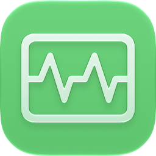

  

<h1 align="center">NiceStats</h1>

Simple system monitor that lives in your menu bar (and doesn't suck!)

## FAQ
* Q: How do I have it startup with my Mac?
  - A: Go to System Settings -> General -> [add NiceStats to the "Open at Login" section](https://files.catbox.moe/ycsntg.jpg).
* Q: What versions are supported?
  - A: Theoretically, it should work on macOS 14.0 and higher but the oldest version that was tested one of the latest versions of Sequoia.
- Q: Intel Mac eta wen?
  - A: I don't have the time to test functionality on Intel Macs especially considering that they're already deprecated. PRs for Intel Macs are welcome however. If someone can confirm whether the tool works on Intel Macs or not, I will update the GitHub Action to build an Intel version.
- Q: Can I contribute?
  - A: Of course! Contributions are more than welcome. Do note that AI usage is restricted here, refer to the CONTRIBUTING.md file.
- Q: Was AI involved in this?
  - A: Yes. I have used an LLM (Sonnet 5.5) for the battery icon, GitHub Actions code, and working on some optimizations. Everything else was coded by me with some review and debugging by said LLM.

## Credits
A good portion of the source code was referenced from [Stats](https://github.com/exelban/stats) (for SMC logic and etc) and [Ampere](https://github.com/MTACS/Ampere) (for the battery icon).

Huge thanks to the following people for helping me with translating the app:

| Language | Translator |
| --- | --- |
| German, Russian | [ZomkaDEV](https://github.com/ZomkaDEV/) |
| Spanish (Latin American) | [etonedemid](https://github.com/etonedemid/), [Snekolotl](https://guns.lol/snekolotl) |
| Korean | [Helloyunho](https://github.com/Helloyunho) |
| French | MrLeRien, [Maelstrom](https://maelstrom.dev) |
| Italian | [chic\_luke](https://t.me/chic_luke) |
| Portuguese | [ChrisCoy](https://github.com/ChrisCoy) |
